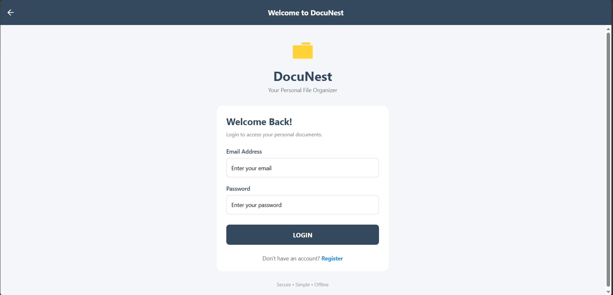
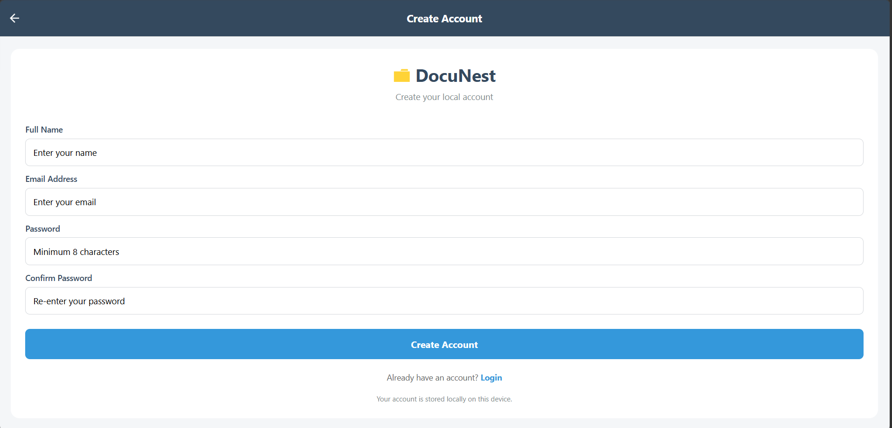
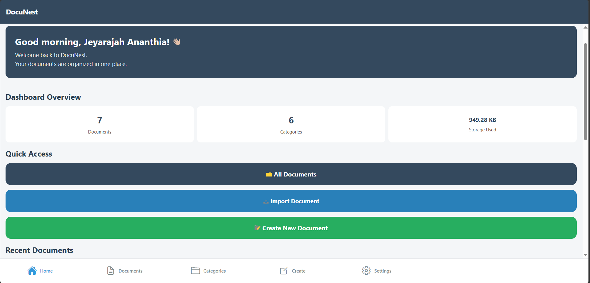
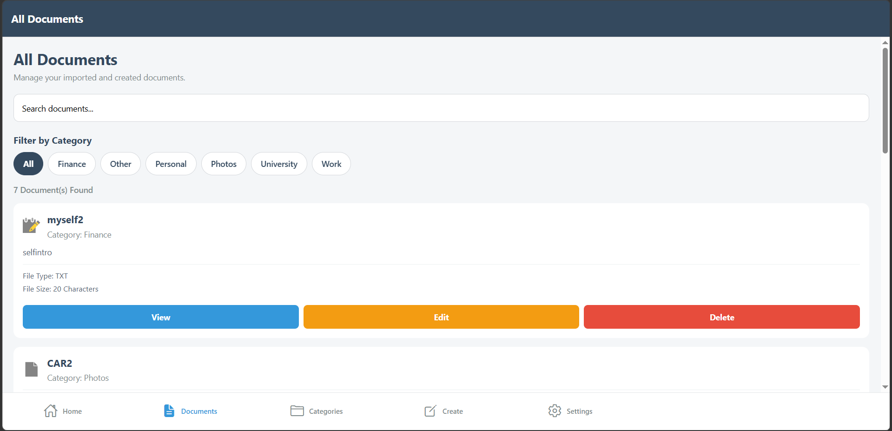
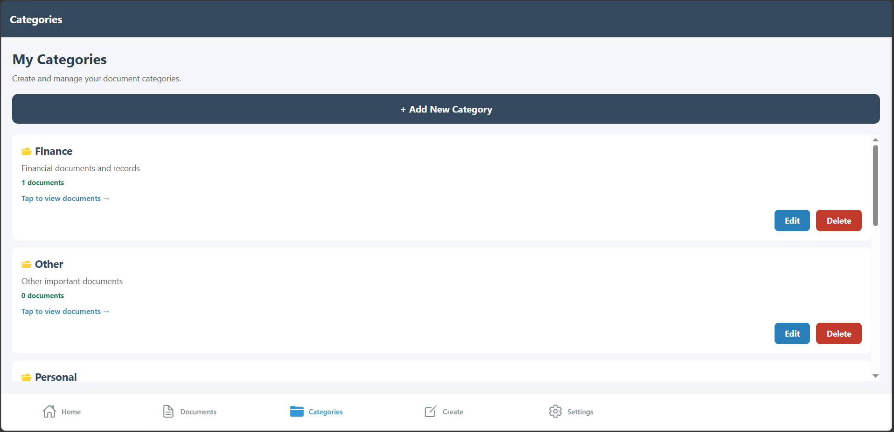
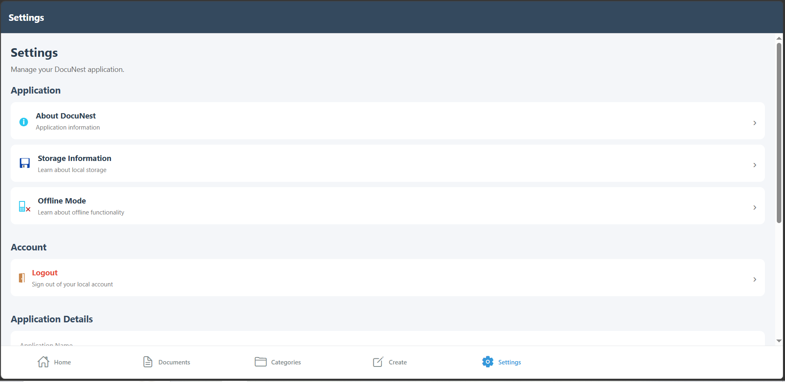

# 📁 DocuNest – Personal File Organizer

DocuNest is a mobile application developed using React Native that helps users efficiently organize and manage their personal documents in one place. Users can upload, categorize, search, view, edit, and delete documents through a simple and user-friendly interface.

The application uses a local SQLite database and is designed to work offline, allowing users to access and manage their documents without an internet connection.

## 🎯 Project Objectives

- To provide a simple and efficient way to organize personal documents.
- To allow users to store and manage documents digitally.
- To make document searching and categorization easier.
- To provide offline access to stored documents.
- To reduce the difficulty of managing multiple files manually.

## ✨ Main Features

- **Login Page** – Allows users to log in using their credentials.
- **Registration Page** – Allows new users to create an account.
- **Dashboard** – Displays an overview of documents and categories.
- **Document Upload** – Import documents from the device.
- **Document Categorization** – Organize documents into different categories.
- **View Documents** – Access stored documents.
- **Search Documents** – Find documents using keywords or file names.
- **Filter Documents** – Filter documents by category or file type.
- **Edit Documents** – Update document information.
- **Delete Documents** – Remove unwanted documents.
- **Create New File** – Create new text files within the application.
- **Offline Access** – Manage documents without an internet connection.
- **User Authentication** – Provides local login and logout functionality.

## 🛠️ Technologies Used

| Technology | Purpose |
|---|---|
| React Native | Mobile application development |
| Expo | Development environment |
| JavaScript | Application programming |
| SQLite | Local database management |
| React Navigation | Screen navigation |
| Expo Document Picker | Selecting documents |
| Expo File System | File management |
| Expo Vector Icons | Application icons |

## 📱 Application Screens

1. Login Screen
2. Register Screen
3. Dashboard Screen
4. All Documents Screen
5. Categories Screen
6. Document Details Screen
7. Create New File Screen
8. Settings Screen

## 📸 Application Screenshots

### Login Screen


### Register Screen


### Home Dashboard


### All Documents


### Categories


### Settings


## 📂 Project Structure

```text
DocuNest/
│
├── assets/
│
├── screenshots/
│   ├── login.PNG
│   ├── register.PNG
│   ├── home.PNG
│   ├── documents.PNG
│   ├── categories.PNG
│   └── settings.PNG
│
├── src/
│   ├── database/
│   ├── navigation/
│   ├── screens/
│   └── services/
│
├── App.js
├── app.json
├── package.json
└── README.md
```

## ⚙️ Installation and Setup

### 1. Clone the Repository

```bash
git clone https://github.com/jeyarajahananthia/DocuNest.git
```

### 2. Navigate to the Project Folder

```bash
cd DocuNest
```

### 3. Install Dependencies

```bash
npm install
```

### 4. Start the Application

```bash
npx expo start
```

### 5. Run the Application

- Scan the QR code using Expo Go.
- Alternatively, run the application using an Android emulator.

## 💾 Database

DocuNest uses SQLite as its local database to store document information and related data.

The database supports:

- Document information management.
- Category management.
- User account information.
- Local data retrieval and updates.

Document files are managed using the device's local file system.

## 🌐 Offline Functionality

DocuNest is designed to operate without an internet connection. Documents and their related information are managed locally on the device, without depending on public APIs or online databases.

## 🎓 Academic Project

**Project Name:** DocuNest – Personal File Organizer

**Project Type:** Individual Mobile Application

**Course:** Mobile Computing

**Development Platform:** React Native with Expo

**Database:** SQLite

---

Developed as part of the Mobile Computing Individual Continuous Assessment (ICA).